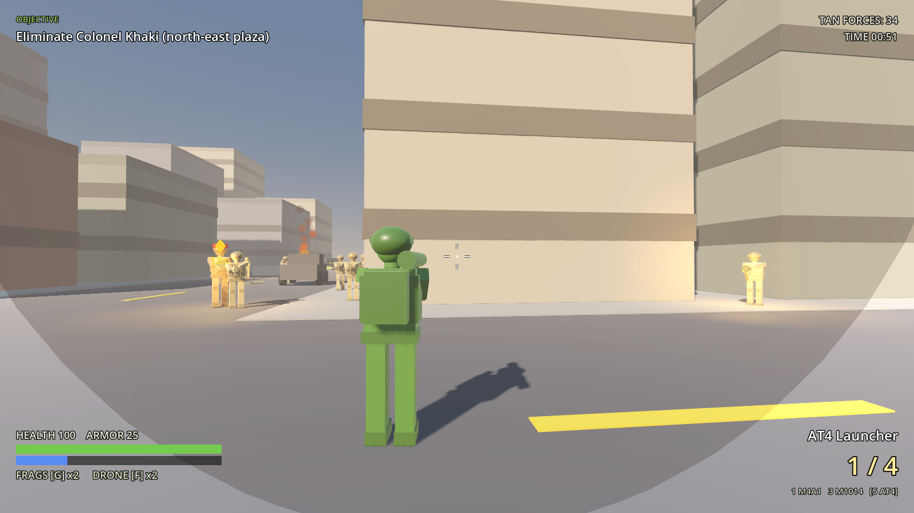

# Plastic Platoon: Revenge 2026

**Plastic soldiers. Modern warfare.**


Plastic Platoon: Revenge 2026 is a third-person toy-soldier shooter built in **Godot 4.3**. You play a green plastic commando fighting the Tan Army across three operations, using modern weapons, kit and air support. Soldiers who die melt into puddles.



**Assets (all CC0, see [CREDITS.md](CREDITS.md) and [docs/ASSET_RESEARCH.md](docs/ASSET_RESEARCH.md)):**
- **Soldiers:** Quaternius's animated Toon Shooter soldier, recolored at runtime to green or tan plastic. It has 17 animations, and the guns switch with your weapon.
- **Buildings and props:** Kenney's City, Car and Nature kits, plus Quaternius's Toon Shooter environment (sandbag trenches, containers, wrecks, chain-reacting explosive barrels).
- **Audio:** recorded gunfire, explosions, reloads and radio chatter, plus orchestral music for each map and ambience (desert wind, city traffic, a giant ticking clock), all from OpenGameArt.
- If an asset is missing, the game falls back to its procedural models and synthesized sounds, so it always runs.

## Running it

1. Install **Godot 4.3** or newer (the standard build, not the .NET build): <https://godotengine.org/download>
2. Open Godot, click **Import**, and select `project.godot` in this folder.
3. Press **F5** (Run Project).

The project uses the Forward+ renderer. On older GPUs or integrated graphics, switch to the Compatibility renderer: **Project → Project Settings → Rendering → Renderer → Rendering Method = gl_compatibility**.

### Building a Windows .exe

**Editor → Manage Export Templates → Download**, then **Project → Export… → Add… → Windows Desktop → Export Project**.

## Performance

**Settings → Graphics quality:**

| Preset | Anti-aliasing | Ambient occlusion | Glow | Shadows | 3D resolution |
|---|---|---|---|---|---|
| Low | Off | Off | Off | Short | 75%, FSR upscaled |
| Medium (default) | 2× MSAA | Off | On | Medium | Full |
| High | 4× MSAA | On | On | Long | Full |

You can also cap the frame rate (match the screen, 60 or 120) and turn on an FPS counter.

On laptops with two graphics chips, make sure Windows runs the game on the dedicated one: Settings → System → Display → Graphics → add `PlasticPlatoon.exe` → High performance.

## Controls

| Key | Action |
|---|---|
| W A S D | Move |
| Mouse | Look / aim |
| Left click | Fire |
| Right click | Aim down sights (the Mk 22 uses a scope) |
| Shift | Sprint |
| C / Ctrl | Crouch (makes you harder to spot) |
| Space | Jump |
| R | Reload |
| 1–5 / mouse wheel | Switch weapon |
| G | Throw frag grenade |
| F | Call a Reaper drone strike on the crosshair |
| E | Get in or out of a jeep or tank |
| T | Squad: hold position / follow me |
| Esc / P | Pause |

## Arsenal

| Slot | Weapon | Notes |
|---|---|---|
| 1 | M4A1 Carbine | Full-auto all-rounder |
| 2 | M249 SAW | 100-round belt; suppress them |
| 3 | M1014 Shotgun | Close quarters |
| 4 | Mk 22 Sniper Rifle | Scoped; headshots deal 2.2× damage |
| 5 | AT4 Launcher | Splash damage; deals full damage to objectives |
| G | M67 Frag | Cooks for 2.4 s |
| F | Reaper drone | Marks the target, then a Hellfire strike lands 2.7 s later |

Bullets deal only 30% damage to objective hardware (radar jammers, SAMs and boosters). Use the AT4, grenades or a drone strike on them.

## Safe zone

Each operation starts inside a **safe zone**, shown as a faint green ring with a "SAFE ZONE" sign:
- While you're inside it, Tan soldiers and vehicles won't target you, and nothing can hurt you, including stray rockets and splash damage.
- Tan forces won't walk or drive into it.
- Firing from inside leaves you exposed for 3 seconds, so you can't snipe safely from the zone.

The HUD shows when you're protected. In co-op everyone respawns here too, so nobody gets spawn-camped.

## MELTDOWN (wave survival)

Something went wrong with General Beige's paint. The Tan soldiers it touched came back melted, and now they want green plastic. Pick **Meltdown** on the main menu, choose a map, and see how long you can hold out. Each map keeps its own best wave.

| Map | Rooms | Junk piles cost |
|---|---|---|
| **The Basement** | Toy Shelf → Workshop → Boiler Room | 750, 1250 |
| **The Attic** | Storage Corner → Rafters (extra wide) → Toy Chest Loft | 750, 1500 |
| **The Garden Shed** | Potting Shed → glass-walled Greenhouse → Compost Corner, at night | 750, 1250 |
| **Toy Store After Hours** | Checkout → Action Figure Aisle (shelving rows) → Stockroom | 1000, 1250 |

The toy store's sniper is on the checkout wall, so it's available from the start.

New maps go in `scripts/meltdown_maps.gd`. `_rooms()` builds a row of rooms with window gaps and junk-pile doors. `tests/meltdown_test` checks every map's windows, stations and paths automatically.

- **Waves.** Melties gather in the crawlspace outside, rip the boards off the windows, climb in and come for you. Each wave has more of them, with more health, more speed and harder swipes.
- **Kinds of Melty:**

  | Kind | From wave | What it does | Coins per kill |
  |---|---|---|---|
  | Melty | 1 | The basic shambler | 60 |
  | Sprinter | 3 | Thin, fast and fragile | 50 |
  | Popper | 4 | Glowing orange belly; it bursts when it reaches you, or when it dies, so shoot it from a distance | 70 |
  | Brute | 5 | Huge, slow, hits hard and rips two boards per swing (at most three at a time) | 120 |
  | Spitter | 6 | Hangs back about 11 m and lobs molten plastic | 90 |

  A headshot adds 40 coins.
- **Bosses** arrive every 5th wave, with fewer regular Melties that wave. Each boss has a health bar at the top of the screen. When it's beaten it pays 500 coins and drops ammo, armor and health.
  - **The Big Melt** (waves 5, 15, ...): a giant. It smashes a window open in one swing, ground-slams anyone close, and calls in Sprinters.
  - **The Molten Major** (waves 10, 20, ...): stands off and fires volleys of molten blobs, and also calls in Sprinters.
- **Coins.** You earn coins for:

  | Action | Coins |
  |---|---|
  | Hit | 10 |
  | Kill | 60 |
  | Headshot kill | 100 |
  | Board nailed back on a window (hold E) | 10, up to 100 per wave |

  You start with 500.
- **Spending.** Press E at a station:

  | Room | Station | Cost |
  |---|---|---|
  | Toy Shelf (start) | M1014 Shotgun | 500 |
  | Toy Shelf | Field Medic | 300 |
  | Workshop | M249 SAW | 1250 |
  | Workshop | MK 22 Sniper | 1000 |
  | Workshop | Plate Armor | 400 |
  | Workshop | Mystery Crate (random gun) | 950 |
  | Boiler Room | AT4 Launcher | 2000 |
  | Boiler Room | Re-Mold Press (double damage for the gun in your hands) | 3000 |

  Buying a gun you already own refills its ammo for half price.
- **Sections.** Junk piles block the way into the next room; prices are in the map table above. Each new room has better gear, and more windows the Melties can come through.
- **Game over** when you melt. The end screen shows the wave you reached, and your best wave is saved.

Your AI squad comes along if you have one set in Settings.

## AI squadmates

In single-player, **Pvt. Sprue** and **Cpl. Rivets** deploy with you, and **Pvt. Pickles** joins if you set the squad to 3. You can pick 0 to 3 squadmates in Settings.

- They follow you in formation, on foot or behind your jeep or tank. If one falls far behind out of sight, they catch up.
- They shoot any Tan soldier they can see, and the Tan Army shoots back at them.
- Press **T** to have them **hold** where they're standing, and press it again to bring them back to **follow** you.
- A squadmate who melts is replaced by a reinforcement next to you 20 seconds later.
- They heal slowly when they're out of the fight. Their plastic is tough enough to shrug off most of your own grenade blasts, and your rockets fly past them.
- The HUD (top right) shows each squadmate's health and the current order.

- **They ride with you.** When you get into a vehicle, squadmates within about 40 m run over and climb aboard, and anyone further away (out of sight) catches the ride. Riders duck down in their seats, stand up to shoot at Tan soldiers they can see, and hop off when you get out. If the vehicle is destroyed, they bail out hurt but alive. A squad on hold stays put.

| Vehicle | Seats |
|---|---|
| Troop carrier | 4 seats in the open-top bay |
| Jeep | Front passenger plus 2 in the back |
| Tank | 3 riders hang on to the rear deck |
| Helicopter | 4 door gunners, two in each open doorway |

They still can't drive, pick up crates, rescue POWs or extract for you; those are your job. In LAN co-op your teammates are your squad, so no AI squadmates deploy.

## Vehicles

The **troop carrier** is an eight-wheeled, open-top APC with a .50 cal on the cab roof and four seats in the back for your squad. It's tougher than the jeep, faster than the tank, and parked at the start of Dust Lid, Concrete Jungle, Snow Globe, Green Hell, Beachhead, Night Shift and Mountain Pass.

The **helicopter** has a nose minigun, two rocket pods and an open-door cabin with four seats for your squad, who fire from the doorways. It's parked at the start of Dust Lid, Snow Globe, Green Hell, Beachhead, Night Shift and Mountain Pass.

| Key | Action |
|---|---|
| W / S | Fly forward / back |
| A / D | Strafe |
| Mouse | Turn the nose and aim |
| Space / C | Climb / descend |
| LMB | Minigun |
| RMB | Rockets |
| E | Get out (only once you've landed; it says "LAND FIRST" otherwise) |

It flies up to 45 m above the ground. If it's shot down, everyone aboard falls clear. Riders take a knock but survive.

Walk up to a jeep or tank and press **E**. WASD drives, the mouse aims the mounted gun, and **LMB** fires. Press **E** again to get out.

| Vehicle | Armour | Weapons | Notes |
|---|---|---|---|
| Jeep | 320 HP | M2 .50 cal (full-auto) | Fast (about 85 km/h). Ramming Tan soldiers flattens them. |
| Tank | 1000 HP, shrugs off bullets | 120 mm cannon (LMB, 7 m blast radius) and coax MG (RMB) | Slow, turns in place. The turret follows your aim at its own speed. |

Rockets, grenades and drone strikes still hurt vehicles. If your vehicle is destroyed, you're thrown clear and take some damage.

### Tan Army vehicles

The Tan Army fields its own tan-plastic jeeps and tanks on every map:
- **Desert:** two jeeps (one patrolling the village, one on the western approach) and a tank inside the compound.
- **City:** two jeeps on the outer streets, a tank at the north crossroads, and one guarding Colonel Khaki's plaza.
- **Tabletop:** a jeep among the energy drinks and a tank by the north booster.

How they behave:
- They patrol near their post. They react when they spot you, hear gunfire nearby or take a hit.
- **Tan jeeps** close in to about 22 m and circle you while the gunner fires bursts. They'll run you over if you're on foot.
- **Tan tanks** hold off at 35–45 m, turn to face you, and fire the cannon once the turret is lined up (about every 4–5 s). They also use the coax MG at close range.
- They don't chase you across the whole map; they stay within a set distance of their post.
- If you're driving, they target your vehicle.

**How to kill them:** tank armour shrugs off rifle fire, so use the AT4, frags, a drone strike or your own tank. Each one destroyed counts toward Tan forces and the "clear the table" objective.

## Multiplayer (LAN co-op, up to 4 players)

**Main menu → Multiplayer (LAN)**, then:
1. **One player hosts.** They type a name, click **Host a game**, pick the operation, and press **START** once everyone is in.
2. **Everyone else joins.** Games on your network show up in the list automatically, or you can type the host's IP address.
3. **Firewall:** allow Plastic Platoon through Windows Firewall when asked. It uses UDP ports 7777 (game) and 7778 (finding games on the network).

**How co-op works**
- The host runs the Tan Army, objectives and damage. Each player moves their own soldier and drives their own vehicle on their own PC, so controls feel instant.
- There's no friendly fire. If you go down, you're back in 8 seconds. The mission only fails if the whole squad is down at the same time.
- Any player can capture a pickup or claim an empty vehicle (press E), and any player reaching the helipad triggers extraction.
- Esc opens a menu but doesn't pause the game. If a player leaves, the rest carry on. If the host leaves, everyone returns to the menu.
- PNN news breaks are skipped in LAN games so the squad stays in step.

**Testing it:** run two copies of the game on one PC (one hosts, the other joins `127.0.0.1`), or use the automated two-process test:

```bash
godot --headless --path . res://tests/mp_test.tscn -- host &
godot --headless --path . res://tests/mp_test.tscn -- client
```

## PNN: the Plastic News Network

Before and after each operation, the Plastic News Network breaks in with the headlines. It's parody news: silly for kids, with a dry grown-up undertone. Everything in it is made up: no real people, places or events.

- **Chip Plasterson**, the anchor, "molded since 1962"
- **Brenda Mold**, the co-anchor, unimpressed
- **Gary**, the field reporter, who has sand in everything

The after-action report reacts to how you played. Lots of headshots, spraying everywhere, a speed run and failing each get their own segment.

The anchors **read their lines aloud** with pre-recorded neural voices (Kokoro-82M):

- Chip: a warm American anchorman.
- Brenda: a crisp British co-anchor.
- Gary: an excitable British field reporter.

Any line without a recording falls back to the PC's own speech voices, or cartoon gibberish if it has none.

To re-record after editing `scripts/news_scripts.gd`:

```
godot --headless --path . res://tests/export_voice_lines.tscn -- lines.json
python tools/make_voices.py lines.json assets/audio/voice
```

Spoken lines must not contain `{placeholders}`. Put live numbers in the headlines instead. Space or click skips ahead a line, and Esc skips the whole segment. You can turn news breaks or narration off in Settings. The scripts live in `scripts/news_scripts.gd` if you want to write more.

## Campaign

1. **Operation Dust Lid**: desert FOB, a mud-brick village and a fortified Tan compound with watchtower snipers. Destroy 3 radar jammers, then extract.
2. **Operation Concrete Jungle**: a city grid with rooftop snipers and checkpoints. Eliminate Colonel Khaki, destroy 2 mobile SAMs, then extract.
3. **Operation Tabletop**: a giant kitchen table covered with a laptop, smartphone, energy drinks and a game controller. Destroy 3 Wi-Fi signal boosters, then clear the table.
4. **Operation Snow Globe**: an arctic radar station in falling snow, with a frozen lake and pine forest. Destroy 3 radar dishes, then extract. A new Tan commander, General Beige, is behind it.
5. **Operation Green Hell**: a jungle river and a stepped stone temple. Free 4 Green POWs from bamboo cages, then extract.
6. **Operation Bath Time**: the upstairs bathroom, with a porcelain-cliff bathtub, giant rubber ducks and a shampoo-bottle sniper perch. Blow 3 fuel depots and sink Admiral Ecru.
7. **Operation Beachhead**: storm a beach past steel hedgehogs. Knock out 4 dune bunkers, then take out Major Fawn in the village.
8. **Operation Sandbox**: the backyard, with a sand-castle fort, a garden hose, a gnome and a doghouse. Recover 3 pieces of intel, then extract.
9. **Operation Night Shift**: a container port at night under floodlights and crane-top snipers. Blow 3 fuel depots, then extract.
10. **Operation Bunk Bed**: a kid's bedroom. Reach the toy fort on the rug, hold it for 75 seconds against waves from under the bed, then clear the room.
11. **Operation Mountain Pass**: a snowy canyon with snipers on rock pillars and a bridge over a frozen river. Destroy 2 SAM sites and take out Brigadier Biscuit.
12. **Operation Garage Sale**: a garage with a parked SUV, a workbench and shelves you can climb by ramp. Destroy the gas-can depots, then find 3 pieces of the map.
13. **Operation Beige Dawn**: the living room. General Beige has turned the couch into a fortress and is broadcasting his plan through TV antennas. Destroy them, defeat the General, then extract.

Each operation gets its own PNN news break before and after, telling the story from the kitchen table to the couch.

The campaign eases you in. The briefing and the start of each operation list anything new:

| Operation | You can drive | Weapons that appear | Drone strikes | Tan vehicles |
|---|---|---|---|---|
| 1 | Nothing | M4A1 carbine, AT4 pickup | No | Jeeps |
| 2 | Jeep | + shotgun, M249 | No | + tanks |
| 3 | Jeep | (same) | Yes | |
| 4 | + tank | + Mk 22 sniper | | |
| 5 | + troop carrier | | | |
| 7 | + helicopter | | | |

The Tan Army also gets tougher each operation. Their damage, accuracy and reaction speed scale from ×0.70 on Op 1 to ×1.30 on Op 13, on top of the difficulty setting. LAN co-op and MELTDOWN have everything unlocked.

Finishing an operation unlocks the next one. There are three difficulty levels (Recruit, Regular and Veteran), which change enemy damage, accuracy and reaction time.

## Project layout

```
project.godot            Engine config (autoload: Game)
scenes/main.tscn         Entry scene
scripts/
  game.gd                Autoload: input map, settings/save, difficulty, synthesized SFX
  main.gd                Title diorama, menus, briefing, debrief
  level.gd               Level runtime: builder API, objectives, pause, explosions
  level_data.gd          The 13 maps + briefing text  <- add new maps here
  plastic_soldier.gd     CC0 animated soldier recolored to green/tan plastic
  barrel.gd              Explosive barrels (chain reactions)
  player.gd              Third-person controller, weapons, grenades, drone
  enemy.gd               Tan Army AI (patrol / investigate / combat)
  toy_soldier.gd         Procedural plastic soldier model + melt animation
  weapons.gd             Weapon stats table          <- tune weapons here
  target.gd              Destructible objectives
  pickup.gd              Supply crates
  rocket.gd, grenade.gd, drone_strike.gd, fx.gd, hud.gd, ui_util.gd
assets/
  models/soldier.gltf    Animated soldier (Quaternius, CC0)
  packs/                 Kenney + Quaternius model packs (CC0); use level.prop("pack/file.glb", pos, rot, fit)
  audio/{music,sfx,ambience}   CC0 audio; drop-in replacements are picked up by name
tests/
  smoke_test.tscn        Headless playthrough of all operations
  screenshot.tscn        Renders menu/level screenshots
```

### Adding a map

Add an entry to `META` in `level_data.gd`, write a `static func _yourmap(L) -> Dictionary` that uses the helpers (`L.prop` for any model in `assets/packs`, `L.box`, `L.cyl`, `L.wall`, `L.add_enemy`, `L.add_target`, `L.add_pickup`, `L.add_barrel`, …), and route to it from `build()`. The objective types are:

- `destroy`: tag
- `kill_hvt`
- `kill_all`
- `extract`: pos
- `reach`: pos, radius
- `collect`: kind `intel` or `pow`; add the items with `L.add_pickup`
- `defend`: pos, radius, time; troops placed with `L.add_reserve` attack the point when it starts

For night or indoor maps, `L.lamp(pos, color, range)` adds lights and `L.water(pos, size)` adds puddles you can wade through. Set `"snow": true` in a map's settings for falling snow.

### Tests

Run the smoke test from the project folder:

```bash
godot --headless --path . res://tests/smoke_test.tscn
```

It plays through every operation (spawning, firing, grenades, drone strikes, AI engagement, objectives, extraction, pause/restart and death) and exits non-zero on failure.

`tests/campaign_test.tscn` builds all 13 operations, checks that no soldier, pickup or player spawns inside the scenery, plays every objective chain to MISSION ACCOMPLISHED, and plays every PNN segment. To check a single map, pass its range, for example `-- 9 9`. `tests/mp_test.tscn` is the two-process LAN co-op test.

## Ideas for next steps

- Vehicles: a drivable JLTV, a Tan APC and an attack helicopter
- More recorded SFX from the Sonniss GDC bundle (see docs/ASSET_RESEARCH.md)
- Navmesh pathfinding (the current AI uses steering and line of sight)
- Split-screen or online co-op
