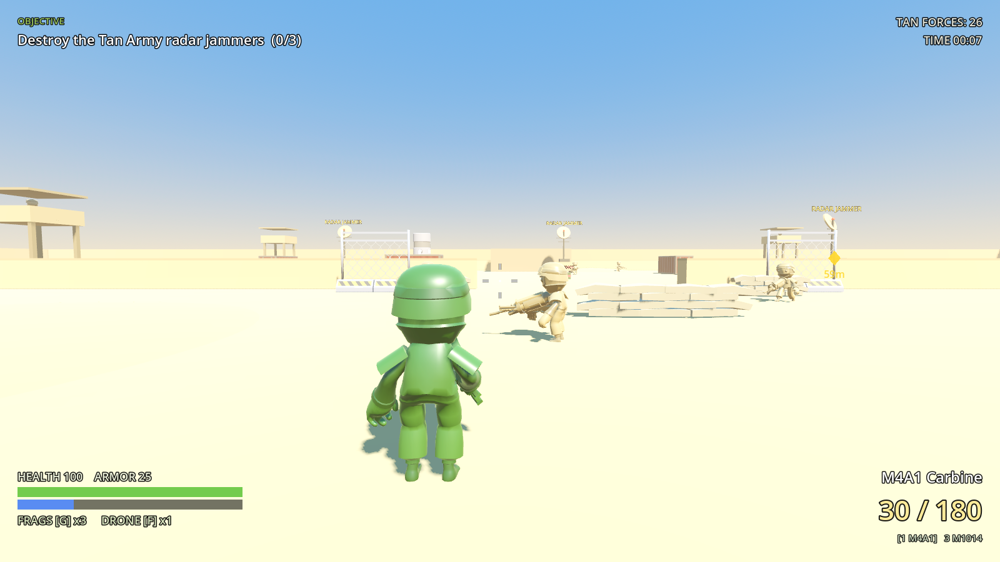

# Plastic Platoon: Revenge 2026

**Plastic soldiers. Modern warfare.**



Plastic Platoon: Revenge 2026 is a third-person toy-soldier shooter built in **Godot 4.3**. You play a green plastic commando fighting the Tan Army across three operations, using modern weapons, kit and air support. Soldiers who die melt into puddles.


**Assets (all CC0, see [CREDITS.md](CREDITS.md) and [docs/ASSET_RESEARCH.md](docs/ASSET_RESEARCH.md)):**
- **Soldiers:** Quaternius's animated Toon Shooter soldier, recolored at runtime to green or tan plastic. It has 17 animations, and the guns switch with your weapon.
- **Buildings and props:** Kenney's City, Car and Nature kits, plus Quaternius's Toon Shooter environment (sandbag trenches, containers, wrecks, chain-reacting explosive barrels).
- **Audio:** recorded gunfire, explosions, reloads and radio chatter, plus orchestral music for each map and ambience (desert wind, city traffic, a giant ticking clock), all from OpenGameArt.
- If an asset is missing, the game falls back to its procedural models and synthesized sounds, so it always runs.

## Running it

1. Install **Godot 4.3** or newer (the standard build, not the .NET build): <https://godotengine.org/download>
2. Open Godot, click **Import**, and select `project.godot` in this folder.
3. Press **F5** (Run Project).

The project uses the Forward+ renderer. On older GPUs or integrated graphics, switch to the Compatibility renderer: **Project → Project Settings → Rendering → Renderer → Rendering Method = gl_compatibility**.

### Building a Windows .exe

**Editor → Manage Export Templates → Download**, then **Project → Export… → Add… → Windows Desktop → Export Project**.

## Controls

| Key | Action |
|---|---|
| W A S D | Move |
| Mouse | Look / aim |
| Left click | Fire |
| Right click | Aim down sights (the Mk 22 uses a scope) |
| Shift | Sprint |
| C / Ctrl | Crouch (makes you harder to spot) |
| Space | Jump |
| R | Reload |
| 1–5 / mouse wheel | Switch weapon |
| G | Throw frag grenade |
| F | Call a Reaper drone strike on the crosshair |
| E | Get in or out of a jeep or tank |
| Esc / P | Pause |

## Arsenal

| Slot | Weapon | Notes |
|---|---|---|
| 1 | M4A1 Carbine | Full-auto all-rounder |
| 2 | M249 SAW | 100-round belt; suppress them |
| 3 | M1014 Shotgun | Close quarters |
| 4 | Mk 22 Sniper Rifle | Scoped; headshots deal 2.2× damage |
| 5 | AT4 Launcher | Splash damage; deals full damage to objectives |
| G | M67 Frag | Cooks for 2.4 s |
| F | Reaper drone | Marks the target, then a Hellfire strike lands 2.7 s later |

Bullets deal only 30% damage to objective hardware (radar jammers, SAMs and boosters). Use the AT4, grenades or a drone strike on them.

## Safe zone

Each operation starts inside a **safe zone**, shown as a faint green ring with a "SAFE ZONE" sign:
- While you're inside it, Tan soldiers and vehicles won't target you, and nothing can hurt you, including stray rockets and splash damage.
- Tan forces won't walk or drive into it.
- Firing from inside leaves you exposed for 3 seconds, so you can't snipe safely from the zone.

The HUD shows when you're protected. In co-op everyone respawns here too, so nobody gets spawn-camped.

## Vehicles

Walk up to a jeep or tank and press **E**. WASD drives, the mouse aims the mounted gun, and **LMB** fires. Press **E** again to get out.

| Vehicle | Armour | Weapons | Notes |
|---|---|---|---|
| Jeep | 320 HP | M2 .50 cal (full-auto) | Fast (about 85 km/h). Ramming Tan soldiers flattens them. |
| Tank | 1000 HP, shrugs off bullets | 120 mm cannon (LMB, 7 m blast radius) and coax MG (RMB) | Slow, turns in place. The turret follows your aim at its own speed. |

Rockets, grenades and drone strikes still hurt vehicles. If your vehicle is destroyed, you're thrown clear and take some damage.

### Tan Army vehicles

The Tan Army fields its own tan-plastic jeeps and tanks on every map:
- **Desert:** two jeeps (one patrolling the village, one on the western approach) and a tank inside the compound.
- **City:** two jeeps on the outer streets, a tank at the north crossroads, and one guarding Colonel Khaki's plaza.
- **Tabletop:** a jeep among the energy drinks and a tank by the north booster.

How they behave:
- They patrol near their post. They react when they spot you, hear gunfire nearby or take a hit.
- **Tan jeeps** close in to about 22 m and circle you while the gunner fires bursts. They'll run you over if you're on foot.
- **Tan tanks** hold off at 35–45 m, turn to face you, and fire the cannon once the turret is lined up (about every 4–5 s). They also use the coax MG at close range.
- They don't chase you across the whole map; they stay within a set distance of their post.
- If you're driving, they target your vehicle.

**How to kill them:** tank armour shrugs off rifle fire, so use the AT4, frags, a drone strike or your own tank. Each one destroyed counts toward Tan forces and the "clear the table" objective.

## Multiplayer (LAN co-op, up to 4 players)

**Main menu → Multiplayer (LAN)**, then:
1. **One player hosts.** They type a name, click **Host a game**, pick the operation, and press **START** once everyone is in.
2. **Everyone else joins.** Games on your network show up in the list automatically, or you can type the host's IP address.
3. **Firewall:** allow Plastic Platoon through Windows Firewall when asked. It uses UDP ports 7777 (game) and 7778 (finding games on the network).

**How co-op works**
- The host runs the Tan Army, objectives and damage. Each player moves their own soldier and drives their own vehicle on their own PC, so controls feel instant.
- There's no friendly fire. If you go down, you're back in 8 seconds. The mission only fails if the whole squad is down at the same time.
- Any player can capture a pickup or claim an empty vehicle (press E), and any player reaching the helipad triggers extraction.
- Esc opens a menu but doesn't pause the game. If a player leaves, the rest carry on. If the host leaves, everyone returns to the menu.
- PNN news breaks are skipped in LAN games so the squad stays in step.

**Testing it:** run two copies of the game on one PC (one hosts, the other joins `127.0.0.1`), or use the automated two-process test:

```bash
godot --headless --path . res://tests/mp_test.tscn -- host &
godot --headless --path . res://tests/mp_test.tscn -- client
```

## PNN: the Plastic News Network

Before and after each operation, the Plastic News Network breaks in with the headlines. It's parody news: silly for kids, with a dry grown-up undertone. Everything in it is made up: no real people, places or events.

- **Chip Plasterson**, the anchor, "molded since 1962"
- **Brenda Mold**, the co-anchor, unimpressed
- **Gary**, the field reporter, who has sand in everything

The after-action report reacts to how you played. Lots of headshots, spraying everywhere, a speed run and failing each get their own segment.

The anchors **read their lines aloud** using the speech voices built into Windows: Chip and Gary get male voices and Brenda a female one, each with its own pitch and pace. If a PC has no speech voices, you get cartoon gibberish instead. Space or click skips ahead a line, and Esc skips the whole segment. You can turn news breaks or narration off in Settings. The scripts live in `scripts/news_scripts.gd` if you want to write more.

## Campaign

1. **Operation Dust Lid**: desert FOB, a mud-brick village and a fortified Tan compound with watchtower snipers. Destroy 3 radar jammers, then extract.
2. **Operation Concrete Jungle**: a city grid with rooftop snipers and checkpoints. Eliminate Colonel Khaki, destroy 2 mobile SAMs, then extract.
3. **Operation Tabletop**: a giant kitchen table covered with a laptop, smartphone, energy drinks and a game controller. Destroy 3 Wi-Fi signal boosters, then clear the table.

Finishing an operation unlocks the next one. There are three difficulty levels (Recruit, Regular and Veteran), which change enemy damage, accuracy and reaction time.

## Project layout

```
project.godot            Engine config (autoload: Game)
scenes/main.tscn         Entry scene
scripts/
  game.gd                Autoload: input map, settings/save, difficulty, synthesized SFX
  main.gd                Title diorama, menus, briefing, debrief
  level.gd               Level runtime: builder API, objectives, pause, explosions
  level_data.gd          The three maps + briefing text  <- add new maps here
  plastic_soldier.gd     CC0 animated soldier recolored to green/tan plastic
  barrel.gd              Explosive barrels (chain reactions)
  player.gd              Third-person controller, weapons, grenades, drone
  enemy.gd               Tan Army AI (patrol / investigate / combat)
  toy_soldier.gd         Procedural plastic soldier model + melt animation
  weapons.gd             Weapon stats table          <- tune weapons here
  target.gd              Destructible objectives
  pickup.gd              Supply crates
  rocket.gd, grenade.gd, drone_strike.gd, fx.gd, hud.gd, ui_util.gd
assets/
  models/soldier.gltf    Animated soldier (Quaternius, CC0)
  packs/                 Kenney + Quaternius model packs (CC0); use level.prop("pack/file.glb", pos, rot, fit)
  audio/{music,sfx,ambience}   CC0 audio; drop-in replacements are picked up by name
tests/
  smoke_test.tscn        Headless playthrough of all operations
  screenshot.tscn        Renders menu/level screenshots
```

### Adding a map

Add an entry to `META` in `level_data.gd`, write a `static func _yourmap(L) -> Dictionary` that uses the helpers (`L.prop` for any model in `assets/packs`, `L.box`, `L.cyl`, `L.wall`, `L.add_enemy`, `L.add_target`, `L.add_pickup`, `L.add_barrel`, …), and route to it from `build()`. Objective types are `destroy`, `kill_hvt`, `kill_all` and `extract`.

### Tests

Run the smoke test from the project folder:

```bash
godot --headless --path . res://tests/smoke_test.tscn
```

It plays through every operation (spawning, firing, grenades, drone strikes, AI engagement, objectives, extraction, pause/restart and death) and exits non-zero on failure.

## Ideas for next steps

- Vehicles: a drivable JLTV, a Tan APC and an attack helicopter
- Friendly AI squadmates
- More recorded SFX from the Sonniss GDC bundle (see docs/ASSET_RESEARCH.md)
- Navmesh pathfinding (the current AI uses steering and line of sight)
- Split-screen or online co-op
